**Course:** Data Structures and Algorithms

**Name:** Frances Julia Katrice A. Orobia

**Year & Section:** 2nd Year - IT2A

---

## Clinic Queue and Patient Management System

A console-based Java application that helps a small clinic keep patient records and call patients in the right order.

## Project Description

Small clinics often write patient names on paper and call them in a random order. This causes long waits, lost records, and unfair turns.

This program fixes that. The clinic staff can register patients, store their details, and put them in a waiting line. The system then calls patients in **First In, First Out (FIFO)** order, so the patient who came first is called first. Staff can also sort the patient records by name, age, or appointment time to make them easier to read and search.

## Objectives

- Store patient records using Java ArrayLists.
- Manage the consultation line using a Queue (FIFO).
- Sort patient records using two sorting algorithms that I wrote myself: **Bubble Sort** and **Shell Sort**.
- Use loops, methods, and conditions to add, display, search, update, and delete records.
- Check all user input and show clear error messages so the program does not crash.
- Follow the procedural programming approach (no custom classes or objects).

## Use Cases and Features

| #   | Menu option                    | What it does                                                                     |
| --- | ------------------------------ | -------------------------------------------------------------------------------- |
| 1   | Register new patient           | Saves name, age, appointment time, and complaint. The system gives a unique ID.  |
| 2   | Display all patients           | Shows all stored records in a table.                                             |
| 3   | Search patient                 | Finds a patient by ID or by name (part of the name works too).                   |
| 4   | Update patient                 | Changes the name, age, time, or complaint of a patient.                          |
| 5   | Delete patient                 | Removes a patient. If the patient is in the queue, they are removed from it too. |
| 6   | Add patient to queue (Enqueue) | Puts a registered patient at the end of the waiting line.                        |
| 7   | Call next patient (Dequeue)    | Removes and shows the patient at the front of the line.                          |
| 8   | Peek next patient              | Shows who is next without removing them.                                         |
| 9   | Display waiting list           | Shows the whole line in order.                                                   |
| 10  | Check if queue is empty        | Tells if anyone is waiting and how many were served.                             |
| 11  | Bubble Sort                    | Sorts records by name, age, or time. Shows before and after.                     |
| 12  | Shell Sort                     | Sorts records by name, age, or time. Shows before and after.                     |
| 13  | Load sample patients           | Adds 6 sample patients for quick testing.                                        |
| 14  | Exit                           | Closes the program.                                                              |

The queue and the sorting work **together but separately**. The queue holds the order in which patients are called. Sorting only changes how the records are arranged in the list. Sorting does not change the queue order, so the FIFO rule is never broken.

## Data Structure Explanation

### ArrayLists (patient records)

The records are stored in five **parallel ArrayLists**. The information at index `i` in every list belongs to the same patient.

```java
ArrayList<Integer> patientIds
ArrayList<String>  patientNames
ArrayList<Integer> patientAges
ArrayList<String>  appointmentTimes
ArrayList<String>  complaints
```

For example, if Maria is at index 0, then her ID is `patientIds.get(0)`, her name is `patientNames.get(0)`, her age is `patientAges.get(0)`, and so on.

To keep the lists matched:

- When a patient is **added**, one value is added to all five lists.
- When a patient is **deleted**, the same index is removed from all five lists.
- When records are **sorted**, the `swapRecords()` method swaps all five lists at the same time.

### Queue (consultation line)

```java
Queue<Integer> consultQueue = new LinkedList<>();
```

The queue stores **patient IDs**, not copies of the data. This way, if a patient's details are updated, the queue always shows the latest information.

| Queue operation | Java method used       | Menu option |
| --------------- | ---------------------- | ----------- |
| Enqueue         | `add()`                | 6           |
| Dequeue         | `poll()`               | 7           |
| Peek            | `peek()`               | 8           |
| Display         | loop through the queue | 9           |
| Is empty        | `isEmpty()`            | 10          |

The program shows messages when the queue is empty, when a patient is already in the queue, or when a patient ID does not exist.

## Sorting Algorithms

### 1. Bubble Sort (menu option 11)

It goes through the list and compares two neighbors. If they are in the wrong order, it swaps them. This repeats until the list is sorted. It stops early if a full pass has no swaps. A small clinic has a short list of patients, and bubble sort is easy to understand and check. The staff can choose to sort by name, age, or appointment time, in ascending or descending order.

### 2. Shell Sort (menu option 12)

It first compares records that are far apart (a big gap), then reduces the gap until it becomes 1. This moves records closer to the right place faster. If the clinic grows and has many patients, shell sort will be faster than bubble sort. The staff can choose to sort by name, age, or appointment time, in ascending or descending order.

Both sorts show the records of **before** and **after** sorting.

## How to Run the Program

**Requirements:** Java JDK 8 or higher.

1. Download or clone this repository.
2. Open a terminal and go to the project folder.
3. Compile the program:
   ```
   javac ClinicQueueSystem.java
   ```
4. Run the program:
   ```
   java ClinicQueueSystem
   ```
5. Use the number menu to choose an option.

## Screenshots of the System

### 1. Main menu

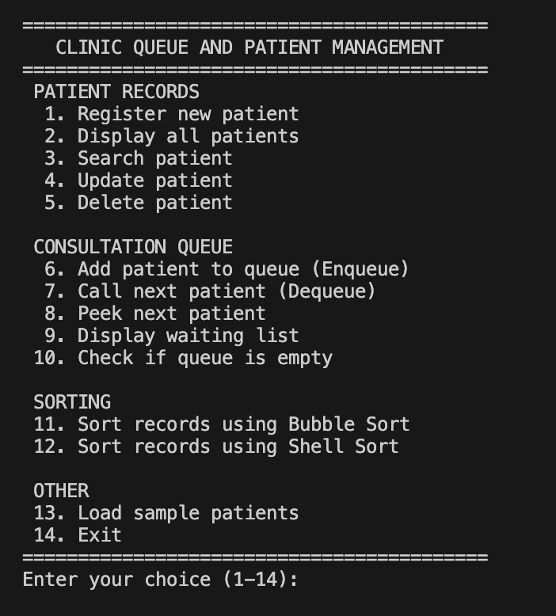

_The menu shows all the options of the system._

### 2. Adding records and displaying stored records

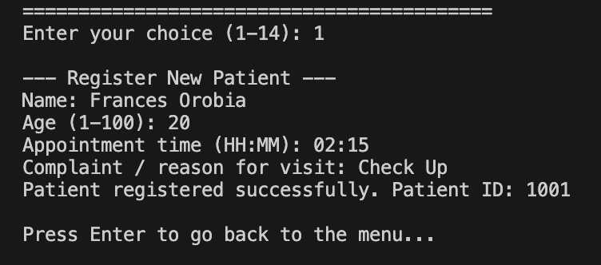


_A new patient is registered, then all records are displayed in a table._

### 3. Queue operations (enqueue, peek, dequeue, display)

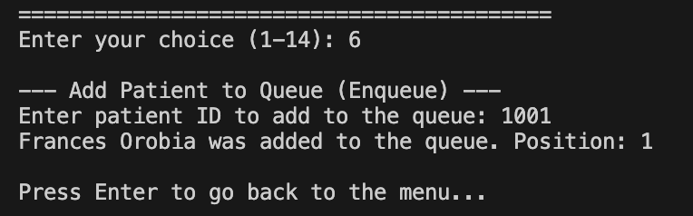
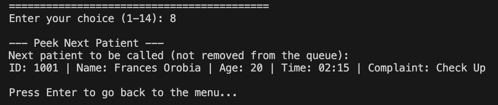
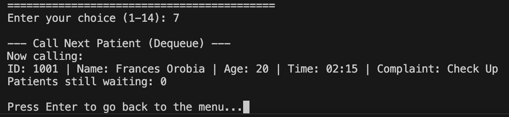
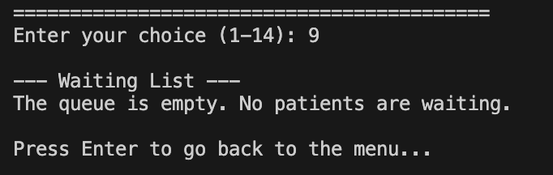

_Patients are added to the queue, the next patient is peeked, one patient is called, and the waiting list is displayed._

### 4. FIFO behavior

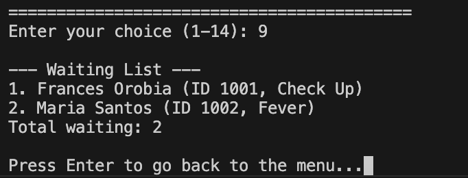
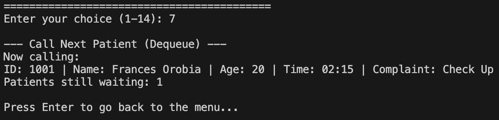
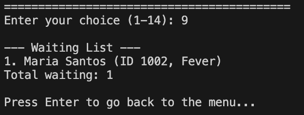

_The first patient added to the queue is the first patient called._

### 5. Bubble Sort (before and after)

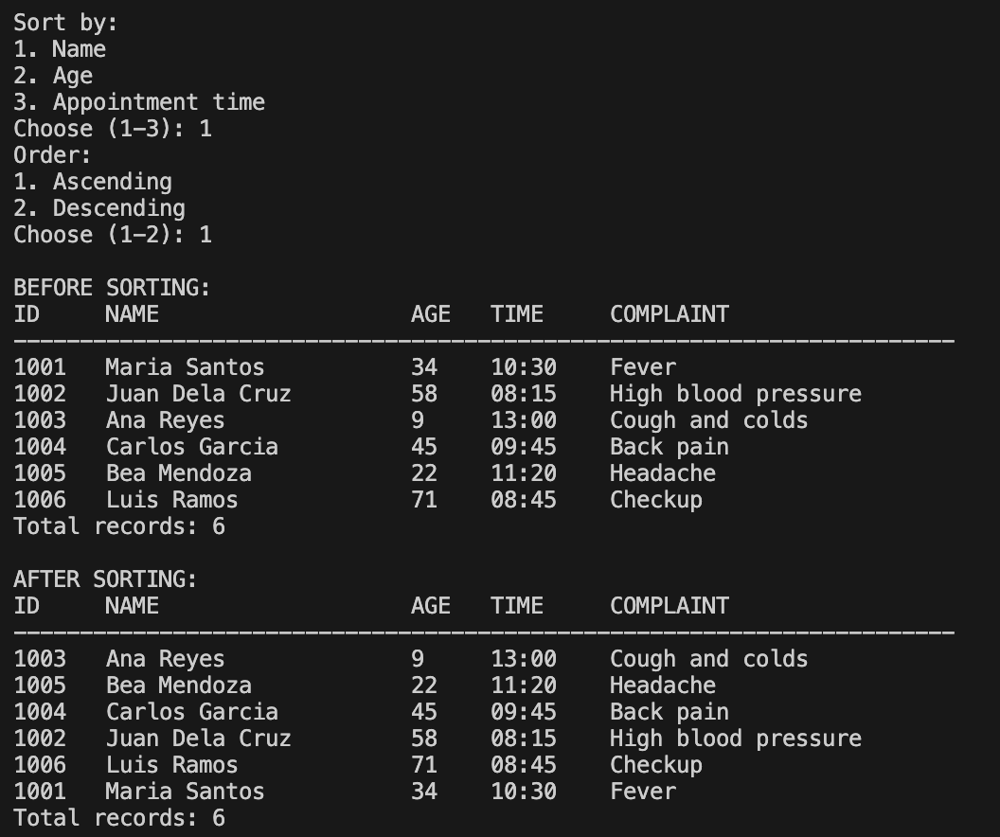

_Records are shown before and after bubble sort._

### 6. Shell Sort (before and after)

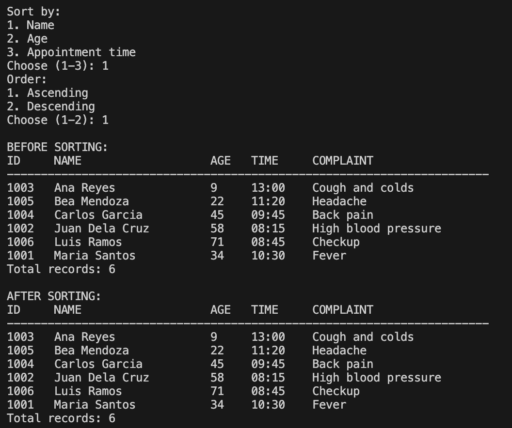

_Records are shown before and after shell sort._

### 7. Input validation and error messages

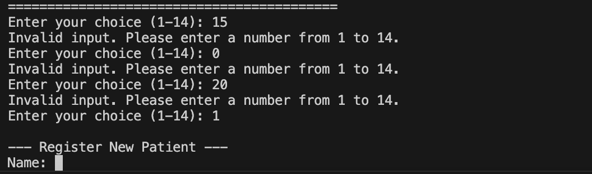
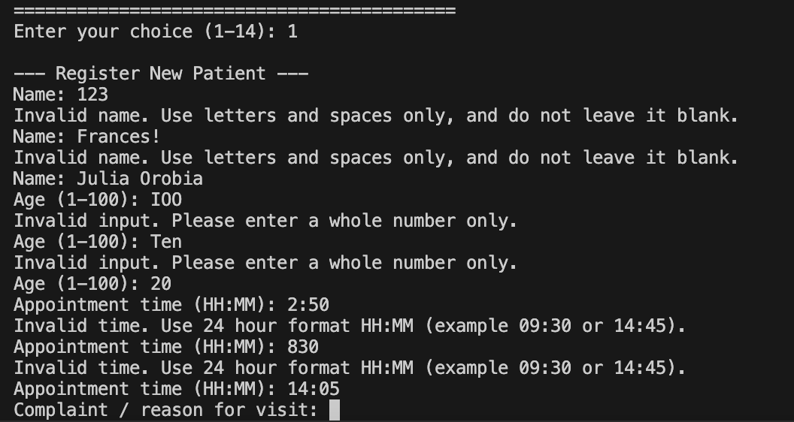

_The program shows error messages for wrong menu choices, invalid names, ages, and times._
